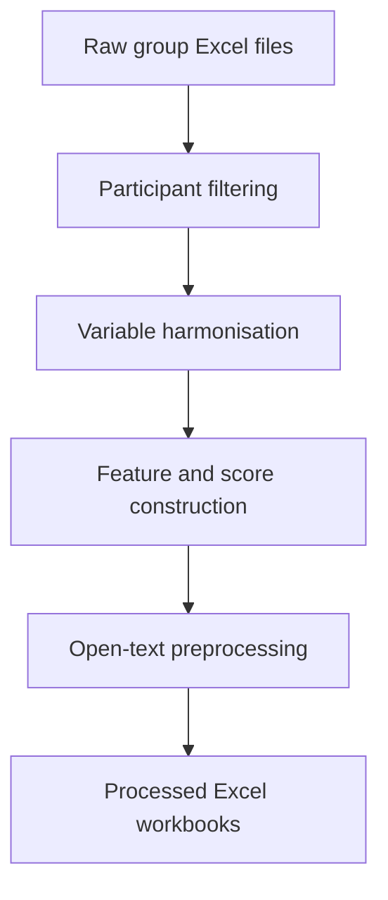

# Animacy Replication Data Pipeline

A Python preprocessing workflow for English-language animacy replication data. It transforms study-specific Excel exports into analysis-ready workbooks while retaining an audit trail for open-text corrections.

## Workflow



## What the pipeline does

1. **Participant filtering and identifiers** — applies completion/progress and age-related exclusion criteria, converts selected fields to numeric values, and assigns sequential participant IDs.
2. **Variable harmonisation** — renames demographic fields and recodes selected categorical responses.
3. **Feature preparation** — creates columns for animate/inanimate interaction ratings and filler responses, and removes export metadata not needed for analysis.
4. **Derived measures** — calculates participant-level means, standard deviations, and response counts for animate and inanimate items, and derives filler scores.
5. **Open-text preprocessing** — applies dictionary-based spelling suggestions and retains original, flagged, and corrected text in separate audit columns.

## Implementation

- **Language:** Python
- **Main script:** `animacy_replication_pipeline.py`
- **Libraries:** pandas, NumPy, openpyxl, pyspellchecker

```bash
pip install pandas numpy openpyxl pyspellchecker
python animacy_replication_pipeline.py --input-dir ./data
```

An output directory and input filename pattern can also be supplied:

```bash
python animacy_replication_pipeline.py \
  --input-dir ./data \
  --output-dir ./processed \
  --pattern "group*.xlsx"
```

## Input data

The workflow expects Excel files matching `group*.xlsx` (or a custom pattern). Source files must follow the questionnaire schema used in the original study, including fields such as `Progress`, `Q3`–`Q56`, and the relevant item columns. The original participant-level data are not included.

## Outputs

For each input workbook, the pipeline writes a corresponding `_processed.xlsx` file. The processing function also returns a dictionary of processed DataFrames.

## Scope and limitations

This is a study-specific pipeline, not a general-purpose Excel ingestion tool. Exclusion thresholds, questionnaire column names, recoding rules, and scoring transformations reflect the original study design.

Dictionary-based spelling corrections are suggestions, not ground truth. Review flagged text before using corrected values in substantive linguistic analyses.

## Related work

The [Animacy and Memory Meta-Analysis](https://github.com/MahdiMoocavi/Meta-Analysis-Animacy) repository contains a related analysis of animacy, interaction ratings, and memory outcomes.
